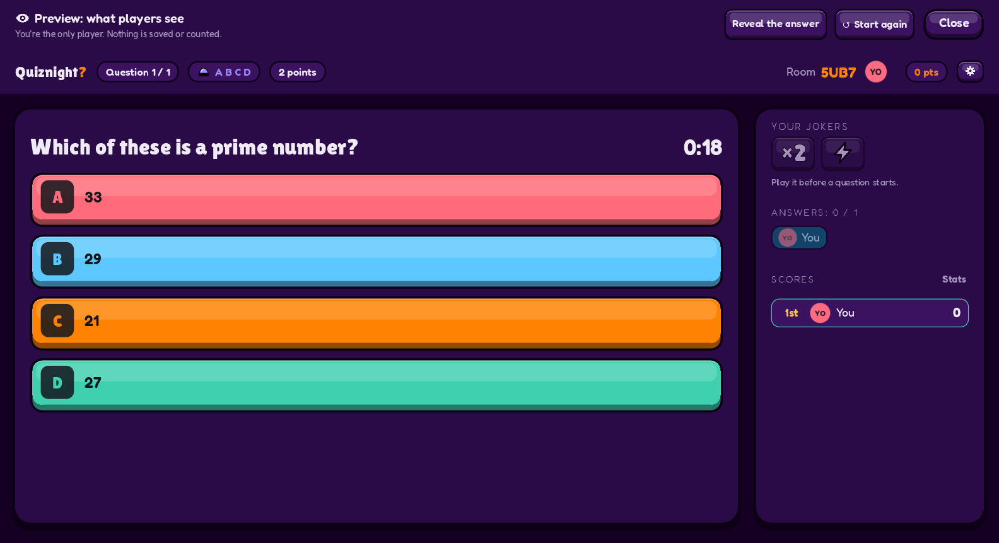
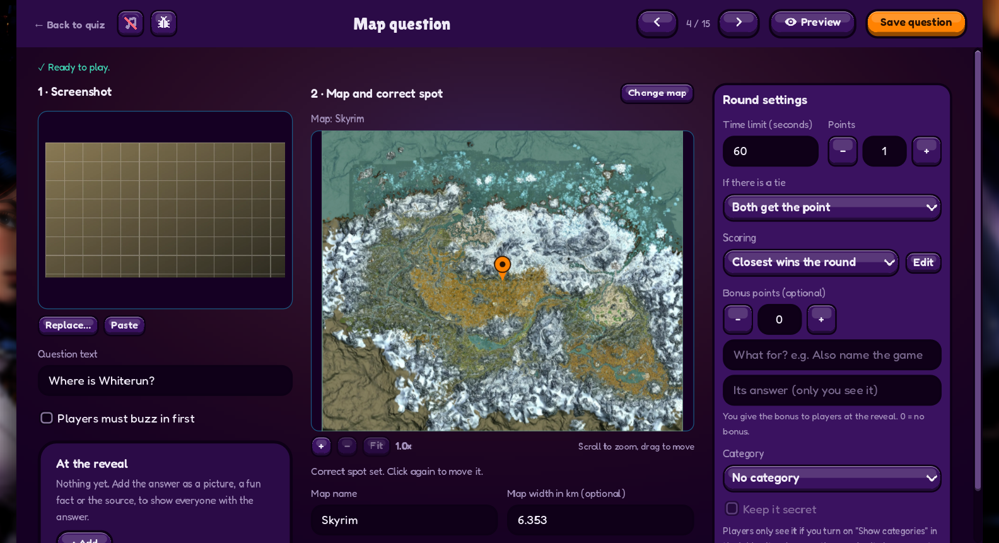
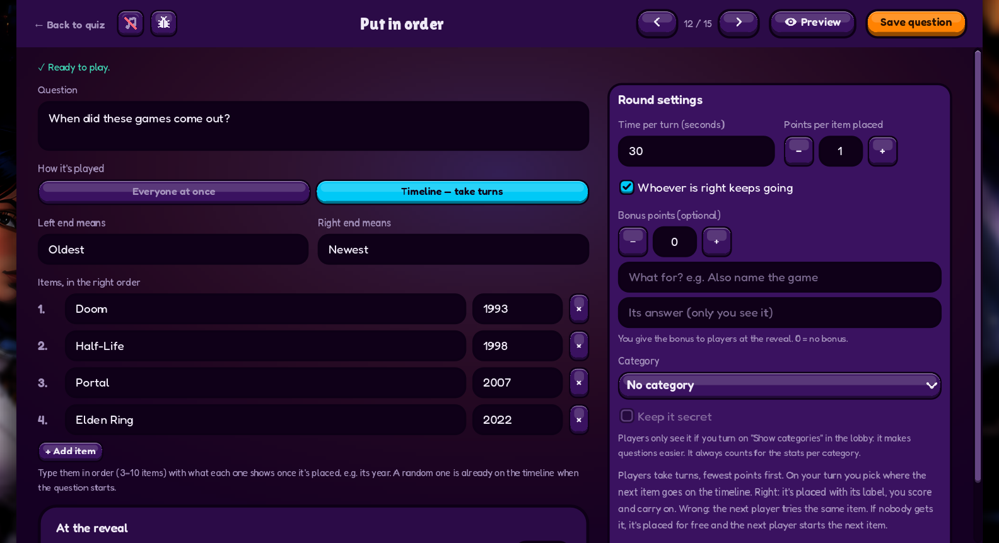

# Quiznight? (Godot)

Host quiz nights with friends, everyone on their own PC (talking on Discord). The host is the quizmaster
(builds the quiz and runs the show, doesn't play); players join with a 4-character room code. Everyone sees and
hears the questions, pictures, sounds and videos on their own screen.

This is the Godot 4.7 (C#) version of Quiznight. It plays over **Steam** (using Valve's Spacewar
test app, so everyone needs Steam running) or over **LAN** (same Wi-Fi, or several windows on one PC).

## Screenshots

| What players see | Map question editor |
|---|---|
|  |  |

## What you can do

- **Build quizzes** in the app — saved in `%APPDATA%\Quiznight\quizzes`, exported as
  `.quiznight.json` files to back up or share. Files exported from the old Quiznight website import as-is.
- **Question types**
  - **Classic** — buzzer (first to buzz says the answer) or A B C D (everyone picks).
  - **Sound** and **Video** — play a song, sound effect or trailer; players buzz in, and everyone sees how
    many seconds it took to guess. Sound: MP3, OGG, WAV. Video: `.ogv` only (convert MP4 with ffmpeg).
  - **Estimation** — closest number wins.
  - **Map pin** — show a screenshot, players pin the spot on a map; scored by real distance on game maps
    (Skyrim, Oblivion, GTA IV/V, WoW Classic with zones).
- **Play** — buzz queue with Correct / Wrong, timers, reveals, scores and a final podium.

## System requirements

Quiznight is a 2D game, so it runs on modest hardware. The minimum is a real test machine (a 2023 thin-and-light laptop with
integrated graphics, 1080p at 60 fps, with the odd hiccup); the recommended spec is a step up from it.

| | Minimum | Recommended |
|---|---|---|
| **System** | Windows 10 or 11, 64-bit | Windows 10 or 11, 64-bit |
| **CPU** | AMD Ryzen 7 7735U (8 cores, 2.7 GHz) or similar | A recent 6-core or better (Ryzen 5 5600, Core i5-12400 or similar) |
| **Graphics** | Integrated: AMD Radeon 680M (what the 7735U has) | A dedicated card of about GTX 1660 / RX 6500 XT class or better |
| **RAM** | 16 GB | 16 GB (the host needs the most headroom: it keeps the quiz's pictures, sounds and videos ready for everyone) |
| **Storage** | About 1 GB free (the download is ~110 MB; map packs and the media cache come on top) | An SSD with a few GB free |
| **Screen** | 1920 x 1080 | 1920 x 1080 or higher |
| **Also needed** | Steam running (to play over Steam), internet connection | A microphone for interactive questions; for hosting, a good upload speed (files go to every player at the start) |

The minimum is what we measured; the recommended spec is our estimate of a machine that never hiccups, not a tested one.

## Run it

1. Open the project in Godot 4.7.2 (.NET / mono version) and press Play — or run it from the command line:
   `Godot_v4.7.2-stable_mono_win64.exe --path .`
2. Start Steam first if you want to play over Steam.
3. **Host:** My Quiznights → build or import a quiz → **Open lobby**, share the code.
   **Players:** choose Steam (or LAN), enter the code (or the host's address) and a name → Join.

To try it alone, use LAN mode: open the game twice (or more) and join `127.0.0.1` from the extra windows.

## Where everything lives

| Repo | What it's for |
|------|---------------|
| [`quiznight`](https://github.com/maxlvl01/quiznight) | The code and the downloads (this repo; called quiznight-godot before 0.13.5). Games from 0.13.5 on update themselves from its releases. |
| [`quiznight-releases`](https://github.com/maxlvl01/quiznight-releases) | The old downloads. Games before 0.13.5 look for updates here, so every public release is copied there too; never delete or rename it. |
| `quiznight-test-releases` (private) | Test builds Max tries before they go public. |
| `quiznight-results` (private) | Quiz night results for the eternal table, bug reports and share codes. Kept apart on purpose: the game ships a token that can write to that repo, so it must not be the code repo. |
| `quiznight-web` (private, archived) | The old web version, kept for reference only. |

## License

Quiznight? is free, and always will be: no purchases, no ads, no donations.

From 0.12 on the code is under the [PolyForm Noncommercial License 1.0.0](LICENSE): anyone may use, change and share
it, but not sell it or use it commercially. (Versions up to 0.11.x were MIT.) **Game map images are not covered** — they belong to their game publishers
(and UESP.net for the Elder Scrolls maps). Game names are trademarks of their owners; Quiznight is a
fan project and not affiliated with them.
